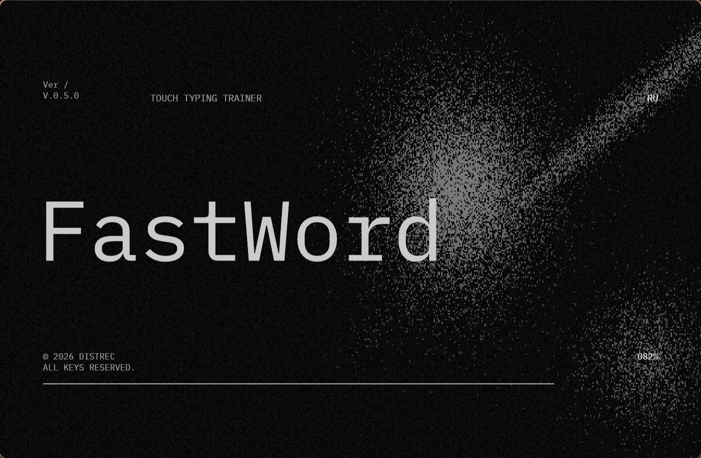
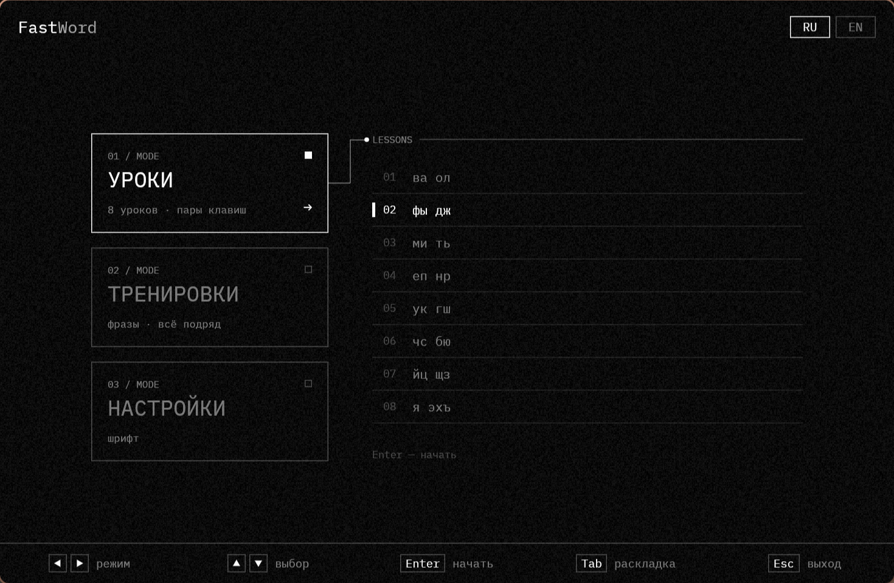

# FastWord

Лёгкий тренажёр слепой печати для русской и английской раскладки. Есть версия с окном и версия для терминала.






## Скачать

Установка не нужна: программа — это один файл.

| Система | С окном — [последняя версия](https://github.com/Distrec/FastWord/releases/latest) | Для терминала — [версия 0.4.0](https://github.com/Distrec/FastWord/releases/tag/v0.4.0) |
|---|---|---|
| Windows | `FastWord-gui-<версия>-windows-x64.exe` | `FastWord-0.4.0-windows-x64.exe` |
| Linux | `FastWord-gui-<версия>-linux-x64` | `FastWord-0.4.0-linux-x64` |

Версия для терминала обновляется реже, чем оконная, поэтому её файлы есть не в каждом релизе. Когда она менялась — см. [историю версии для терминала](#история-версии-для-терминала).

**Windows:** если появится окно «Windows защитила компьютер», нажмите «Подробнее» → «Выполнить в любом случае» — у программы нет цифровой подписи.

**Linux:** сделайте файл исполняемым и запустите:

```sh
chmod +x FastWord-gui-*-linux-x64
./FastWord-gui-*-linux-x64
```

## Что умеет

Окно:

- Экран загрузки и меню из трёх режимов: **«Уроки»**, **«Тренировки»** и **«Настройки»**.
- **Уроки** — 8 уроков по парам клавиш. В каждом печатаются только буквы этого урока. Для урока запоминается лучший результат: скорость, время, точность.
- **Тренировки**:
  - **«Фразы»** — короткие предложения с заглавными буквами, точками и запятыми;
  - **«Всё подряд»** — слова вперемешку с сочетаниями любых букв.
  
  Переключатель **«Конечный / Бесконечный ∞»** над списком. В бесконечном варианте текст подгружается по мере набора, а во «Фразах» предложения перемежаются обычными словами. Если не печатать 3 секунды — пауза, время на паузе не идёт.
- **Настройки → Шрифт**: размер текста (14–32 px), выбор шрифта и добавление своего (`.ttf`, `.otf`) — пункт «Добавить шрифт» открывает папку, куда положить файл. Шрифт и размер меняются у текста для набора.
- Клавиатура с рядом цифр и клавишами Shift. Если нужен Shift (заглавная буква, «!», «?», «,» в русской раскладке), клавиатура показывает верхние символы и подсвечивает Shift той руки, которой надо его нажать.
- Подсказка, каким пальцем нажимать клавишу; у каждого пальца свой узор на клавиатуре.
- Скорость (знаков и слов в минуту), точность и время.
- Предупреждение, если набор идёт не в той раскладке.
- Русская (ЙЦУКЕН) и английская (QWERTY) раскладки; язык меняется в меню.

Версия для терминала: 7 уроков по рядам и бесконечный режим — см. [ниже](#версия-для-терминала).

## Уроки

В каждом уроке печатаются только его клавиши.

| № | RU | EN |
|---|---|---|
| 1 | ва ол | df jk |
| 2 | фы дж | as l; |
| 3 | ми ть | vb nm |
| 4 | еп нр | tg yh |
| 5 | ук гш | er ui |
| 6 | чс бю | qw op |
| 7 | йц щз | xc , . |
| 8 | я эхъ | z ! ? / |

## Управление

В меню:

| Клавиша | Действие |
|---|---|
| ← / → | режим: Уроки / Тренировки / Настройки |
| ↑ / ↓ | выбор пункта |
| Enter | начать (в настройках — изменить) |
| Пробел | в тренировках — конечный / бесконечный; в настройках — изменить |
| − / + | в настройках — размер текста |
| Tab | раскладка RU / EN |
| Esc | выход |

Во время набора:

| Клавиша | Действие |
|---|---|
| ↑ | другие слова (в бесконечном варианте — начать заново) |
| Enter | ещё раз (после окончания) |
| Esc | в меню |

Экран загрузки пропускается любой клавишей.

## Версия для терминала


В терминале — 7 уроков по рядам: каждый добавляет несколько новых букв к уже изученным (основной ряд → верхний → нижний → вся клавиатура), после 7-го — бесконечный режим. Клавиши: ← / → — урок, ↑ — другие слова, Tab — раскладка, Enter — ещё раз, Esc — выход.

### История версии для терминала

| Версия | Дата | Что изменилось |
|---|---|---|
| [0.4.0](https://github.com/Distrec/FastWord/releases/tag/v0.4.0) | 09.11.2026 | Бесконечный режим |
| [0.3.1](https://github.com/Distrec/FastWord/releases/tag/v0.3.1) | 07.11.2026 | Первая сборка для Windows |
| 0.2.0 | 07.11.2026 | Программа получила название FastWord; появилась версия с окном |
| 0.1.0 | 07.11.2026 | Первая версия: 7 уроков, RU/EN, подсказки пальцев, скорость и точность |

В релизах 0.3.0, 0.3.2–0.3.4, 0.4.1–0.6.0 версия для терминала не менялась — обновлялось только окно.

## Сборка из исходников

Нужен [Rust](https://rustup.rs).

```sh
git clone https://github.com/Distrec/FastWord.git
cd FastWord
cargo build --release
```

Готовые файлы: `target/release/fastword` (терминал) и `target/release/fastword-gui` (окно).

Фразы для тренировок лежат в `words/phrases_ru.txt` и `words/phrases_en.txt` — по одной на строку.

## Ошибки и идеи

Нашли ошибку или есть идея — откройте [Issue](https://github.com/Distrec/FastWord/issues/new/choose).

## Лицензия

Код — [MIT](LICENSE): можно свободно использовать, изменять и распространять, сохранив указание автора.

В программу встроен шрифт [IBM Plex Mono](https://github.com/IBM/plex) (SIL Open Font License 1.1, текст — `assets/fonts/IBMPlexMono-LICENSE.txt`).
