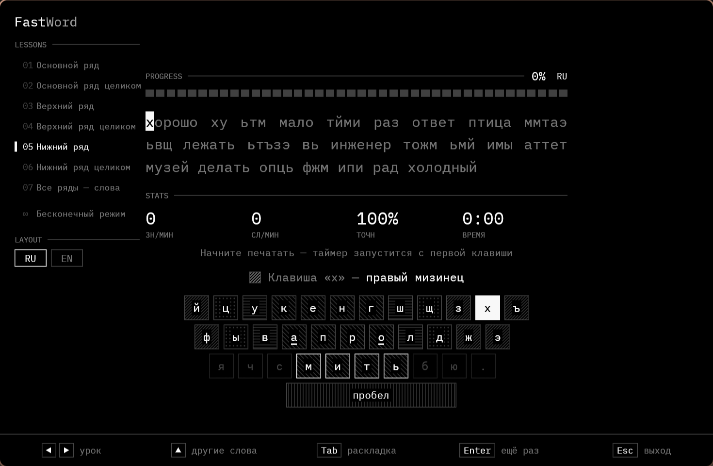
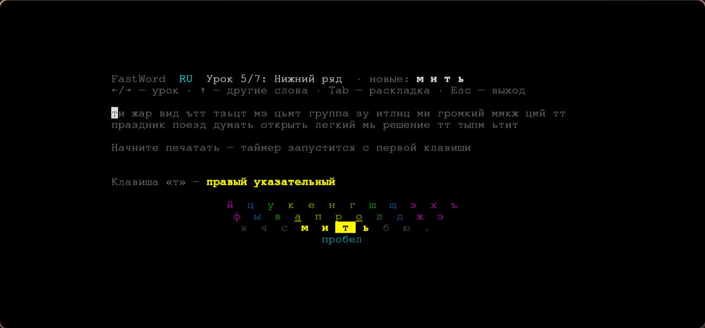

# FastWord

Лёгкий тренажёр слепой печати для русской и английской раскладки. Есть версия с окном и версия для терминала.



## Скачать

Последняя версия — на странице **[Releases](https://github.com/Distrec/FastWord/releases/latest)**. Установка не нужна: программа — это один файл.

| Система | С окном | Для терминала |
|---|---|---|
| Windows | `FastWord-gui-<версия>-windows-x64.exe` | `FastWord-<версия>-windows-x64.exe` |
| Linux | `FastWord-gui-<версия>-linux-x64` | `FastWord-<версия>-linux-x64` |

**Windows:** если появится окно «Windows защитила компьютер», нажмите «Подробнее» → «Выполнить в любом случае» — у программы нет цифровой подписи.

**Linux:** сделайте файл исполняемым и запустите:

```sh
chmod +x FastWord-gui-*-linux-x64
./FastWord-gui-*-linux-x64
```

## Что умеет

- Русская (ЙЦУКЕН) и английская (QWERTY) раскладки.
- 7 уроков: от основного ряда до всей клавиатуры. Каждый урок добавляет несколько новых букв к уже изученным.
- Текст из настоящих слов и буквосочетаний, которые набираются только изученными буквами.
- Подсказка, каким пальцем нажимать клавишу; клавиатура раскрашена по пальцам.
- Скорость (знаков и слов в минуту), точность и время.
- Предупреждение, если набор идёт не в той раскладке.
- Программа запоминает последний урок и раскладку.

## Уроки

| № | Урок | Новые буквы RU | Новые буквы EN |
|---|---|---|---|
| 1 | Основной ряд | ф ы в а о л д ж | a s d f j k l |
| 2 | Основной ряд целиком | п р э | g h |
| 3 | Верхний ряд | к е н г | e r u i |
| 4 | Верхний ряд целиком | й ц у ш щ з х ъ | q w t y o p |
| 5 | Нижний ряд | м и т ь | v b n m |
| 6 | Нижний ряд целиком | я ч с б ю | z x c |
| 7 | Все ряды — слова | вся клавиатура | вся клавиатура |

## Управление

| Клавиша | Действие |
|---|---|
| ← / → | предыдущий / следующий урок |
| ↑ | другие слова |
| Tab | сменить раскладку RU / EN |
| Enter | ещё раз (после окончания) |
| Esc | выход |

## Версия для терминала



## Сборка из исходников

Нужен [Rust](https://rustup.rs).

```sh
git clone https://github.com/Distrec/FastWord.git
cd FastWord
cargo build --release
```

Готовые файлы: `target/release/fastword` (терминал) и `target/release/fastword-gui` (окно).

## Ошибки и идеи

Нашли ошибку или есть идея — откройте [Issue](https://github.com/Distrec/FastWord/issues/new/choose).

## Лицензия

Код — [MIT](LICENSE): можно свободно использовать, изменять и распространять, сохранив указание автора.

В программу встроен шрифт FreeMono из [GNU FreeFont](https://www.gnu.org/software/freefont/) (GPL-3.0-or-later с исключением для шрифтов).
